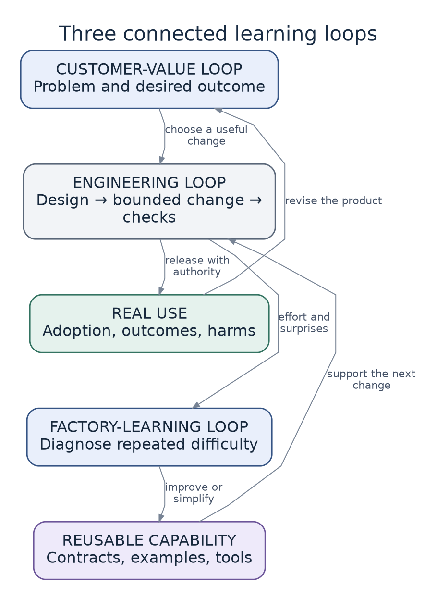

# 3. Our working model

[Five-minute version](../START-HERE.md) · [Reading guide](../READING-GUIDE.md) · [Previous: The perspectives and the tensions](02-the-perspectives-and-tensions.md) · [Next: Discovery and product intent](04-discovery-and-product-intent.md)

> **Status:** Proposed. The loops describe how information should change decisions; they are not evidence that the model is effective.

## The model in one sentence

Choose worthwhile work, deliver it safely, and use what you learn to make the next change easier.

Those responsibilities form three connected loops. They are not departments, agent roles, or mandatory phases. A small task may move through all three in one session.

## Loop 1: customer value

This loop asks:

> Are we solving a worthwhile problem, and did the result help?

For task reassignment, the first question is not how to add an endpoint. It is why supervisors need to move work, who is affected, what “better” means, and what must not get worse.

The output may be a feature. It may also be a smaller scope, a data correction, a process change, or a decision not to build.

A useful outcome hypothesis names:

- the people affected;
- the work they are trying to do;
- the current difficulty;
- the improvement expected; and
- an unacceptable regression.

For example: supervisors can redistribute urgent tasks in less time, without granting new access or losing the assignment history.

DORA connects product decisions with customer interaction and adoption evidence. This book makes that feedback an outer boundary around agent execution rather than an optional activity after delivery. [S13](../research/sources/index.md#s13)

## Loop 2: engineering delivery

This loop asks:

> How can we make and release the accepted change safely?

It includes targeted research, product clarification, technical design, implementation, verification, and release. The depth depends on the task.

For reassignment, the durable rules may include workspace membership, visibility, audit behavior, and conflict handling. The feature design applies those rules to one operation. It should not redraw the entire architecture or silently discard an inconvenient constraint.

The result is a bounded change plus evidence. That evidence may justify another implementation step, a preview, a merge, or a release decision. Those are separate actions with separate authority.

> **Do not confuse:** passing checks with permission to release.

## Loop 3: factory learning

This loop asks:

> Why did this work require so much effort, and what should change next time?

Useful signals include repeated review comments, failed checks, confusing domain terms, surprising dependencies, unavailable environments, long waits, and customer rejection.

Improve the layer that caused the problem:

- repeated unknown permission names may justify a typed registry;
- repeated confusion about membership may justify a clearer domain contract;
- repeated missed denied cases may justify a shared test pattern;
- repeated review reconstruction may justify a focused system view; and
- a template field that never helps may deserve deletion.

The factory must remove bad machinery as readily as it adds new machinery.

## Four capabilities support all three loops

The loops use four capabilities:

1. **Human judgment** supplies intent and owns consequential decisions.
2. **Autonomous execution** investigates and implements within an approved scope.
3. **Verification** tests specific claims.
4. **Make Clear** turns relevant evidence into something a person can understand and challenge.

These are not four stages. Make Clear may help during discovery, design, debugging, review, or learning. Research may happen again during implementation when a new unknown appears.

## Connect judgment to action with six facts

When delegating work, state:

1. the desired outcome;
2. the approved scope;
3. the rules that must remain stable;
4. the evidence required;
5. the actions and environments allowed; and
6. the conditions that require stopping or escalation.

For example, an agent may change private code inside the Tasks module and run a preview with synthetic data. It may not change who can assign, contact real customers, or introduce a paid service.

A missing decision is not a blank check. A small implementation choice is not automatically a reason to interrupt the human. Escalation is needed when the choice would exceed the task's authority or change an important contract.

## Reuse only what earns reuse

Leverage means one investment improves several later actions. A generator, module contract, deny-by-default mechanism, or grounded explanation can do that.

Each also has setup, maintenance, exception, and learning costs. “Reusable” is not the same as “valuable.” Promote a mechanism when repeated evidence justifies it.

## Optimize flow, not agent activity

If agents produce changes faster than people can evaluate them, unfinished work grows. A useful view of the factory shows waiting decisions, reviews, environments, and customer questions—not only active agents.

DORA's work-in-process guidance focuses on the whole value stream and its constraint. Applied here, that may mean pausing new review-heavy work while agents improve evidence or finish existing work. This application is proposed, not measured by this repository. [S12](../research/sources/index.md#s12)

## The operating rules

1. Begin with a worthwhile result.
2. Find the unknown that could change the next decision.
3. Take the smallest credible action that reduces it.
4. Record stable rules where later work can use them.
5. Delegate only the authority actually granted.
6. Match evidence to each claim.
7. Release with appropriate containment and recovery.
8. Observe the customer effect.
9. Improve or simplify the factory when evidence warrants it.

The following chapters explain how to apply these rules without turning them into a fixed ceremony.

---

[Previous: The perspectives and the tensions](02-the-perspectives-and-tensions.md) · [Next: Discovery and product intent](04-discovery-and-product-intent.md)
