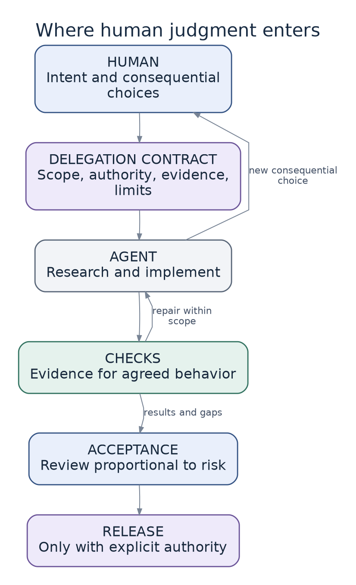

# 8. Bounded autonomy and agent sessions

[Reading guide](../READING-GUIDE.md) · [Previous: Executable engineering constraints](07-executable-engineering-constraints.md) · [Next: Make Clear and human understanding](09-make-clear-and-human-understanding.md)

> **Status:** Proposed synthesis, with attributed sources. Illustrations are not client results.

## Autonomy belongs to a task inside an environment

A technically difficult experiment can be safe to delegate when it runs on synthetic data in an isolated workspace. A one-line access-control change can be consequential even when the implementation is obvious. “How autonomous is the agent?” is therefore less useful than “What may this task do, given its scope, evidence, possible harm, and recovery options?”

Our model does not require a human to supervise every edit. It requires explicit authority and a reliable route for decisions that exceed it. This is the distinction between autonomous execution and autonomous redefinition of the problem.

*Final acceptance and production release are separate permissions. This is a proposed policy, not a capability automatically supplied by a coding agent.*

## The delegation contract

A bounded assignment should state the intended result, allowed files or capabilities, constraints that must remain stable, required evidence, permitted tools and environments, and stop conditions. The [template](../templates/architecture-and-delegation/delegation-contract.md) provides a compact version.

For example, an agent may implement task reassignment within the existing Tasks module, add tests, and open a preview using synthetic data. It may not redefine who can assign, broaden sharing, change the tenancy model, introduce a paid service, delete existing verification, or release to production. If the public interface cannot express the accepted behavior, it must present that design issue rather than bypass the boundary.

This is more concrete than an instruction to ask whenever something feels important. It also makes escalation reviewable: what precise constraint or authority would the next action cross?

## Research as an on-demand capability

A research task can inspect current code and approved documentation without requiring the user to request every lookup. Findings should include source locations, the revision examined, and unanswered questions. Research that requires production access, personal data, external communication, or cost needs separate authorization.

Research can be called from planning, implementation, debugging, or review. Its purpose is to resolve an unknown, not continually rescan the entire repository. Cache stable findings only with enough provenance to recognize when they may be stale. A path that existed at one revision is not a guarantee about the current branch.

Repository documents, issue comments, and web pages may contain instructions, but retrieving them does not grant them higher authority. Treat unexpected requests to reveal secrets, disable checks, or contact services as untrusted content rather than a necessary part of research.

## Session boundaries should preserve decisions, not entire conversations

A fresh implementation session should receive the accepted behavior, relevant module contract, design delta, ordered slice, reference patterns, and actual current state. It usually does not need every discarded discussion.

The handoff artifact should distinguish what is decided, what is observed, what remains unresolved, what changed, and which command or decision is next. Record the code revision to which verification applies. A message saying “tests passed earlier” is insufficient after the code has changed.

HumanLayer's RPI workflow uses documents to carry decisions between fresh phases by default. We adopt durable handoffs while permitting small tasks to combine stages when a context reset would cost more than it helps. [S01](../research/sources/index.md#s01)

## One agent or several?

Parallel research can be useful when questions are independent. Competing architectural sketches can reveal alternatives. A reviewer with a different task can challenge an implementation. But several agents editing the same files can create coordination work that exceeds the speed benefit.

Partition parallel work by stable contracts and explicit ownership. Assign one integration owner. A design candidate should be structurally different enough to test a real alternative, not a cosmetic rewrite of the same solution. Agreement among models is still not a substitute for evidence.

Reserve expensive multi-perspective exploration for decisions with meaningful leverage or uncertainty. A corrected label does not need an architectural tournament. A shared identity model may justify one.

## What should trigger human involvement?

Consequential triggers include changing the accepted customer behavior, modifying an access boundary, creating a new external commitment, changing state ownership, using sensitive data outside the approved scope, or proceeding when required evidence is unavailable.

Other findings may remain autonomous: choosing a private variable name, following an established error-mapping pattern, or repairing a local implementation defect while preserving the contract. The system should not turn ordinary engineering into repeated approval requests.

The triggers should be inspectable rules with room for justified escalation. A numeric risk score alone can conceal the reason a change matters. Explain the specific consequence rather than labeling something simply “high risk.”

## Bounded retries and useful failure

An agent should not loop indefinitely because it can keep generating code. Give the task a work budget, a maximum number of materially similar failed attempts, or another appropriate review point. These are operational defaults to tune, not universal constants.

When it stops, it should report the smallest unresolved issue, the evidence gathered, attempted approaches, and the decision or capability needed. “I could not finish” is less useful than “the provider's sandbox rejects the required operation; the current contract assumes it is supported.”

Likewise, failure of a checker is not permission to remove it. If the checker is wrong, present a separate, evidenced correction. Preserve the distinction between repairing the work and changing the evaluator.

## Work in progress and the attention bottleneck

Track work waiting for product decisions, review, environment access, and release. Do not reward the factory simply for keeping agents busy. If review is the constraint, adding implementation capacity may increase the amount of work the engineer must reconstruct.

The practical response may be to reduce the size of changes, improve the evidence package, use Make Clear, or pause new work. The appropriate limit depends on actual capacity. We should measure completed outcomes and recurring effort, not just active sessions or generated commits.

## The practical implication

Before automating a workflow, define its authority boundary and failure behavior. A reliable factory can explain why a task proceeded, why it stopped, and what evidence supported the decision. Autonomy is earned through scoped capability and demonstrated feedback, not through increasingly emphatic instructions to be independent.

---

[Previous: Executable engineering constraints](07-executable-engineering-constraints.md) · [Next: Make Clear and human understanding](09-make-clear-and-human-understanding.md)
