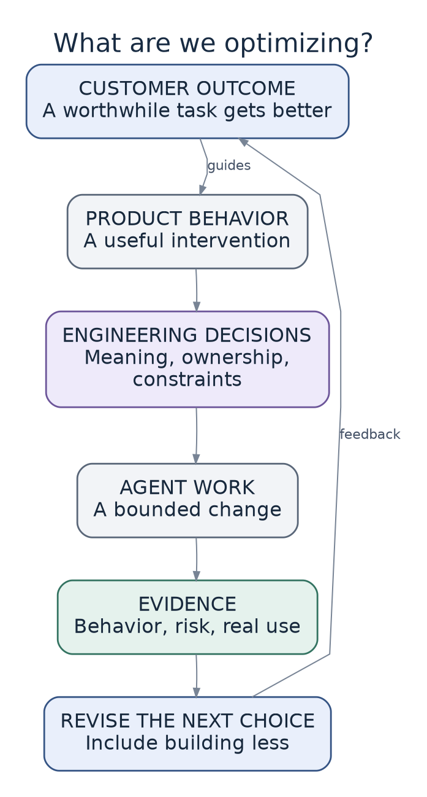
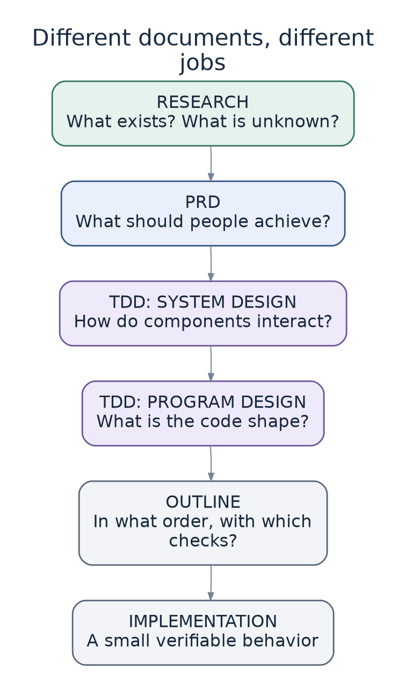
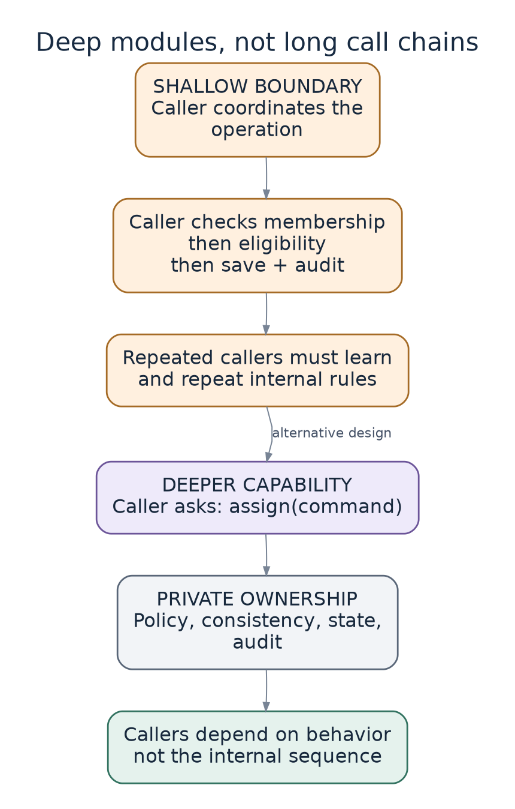
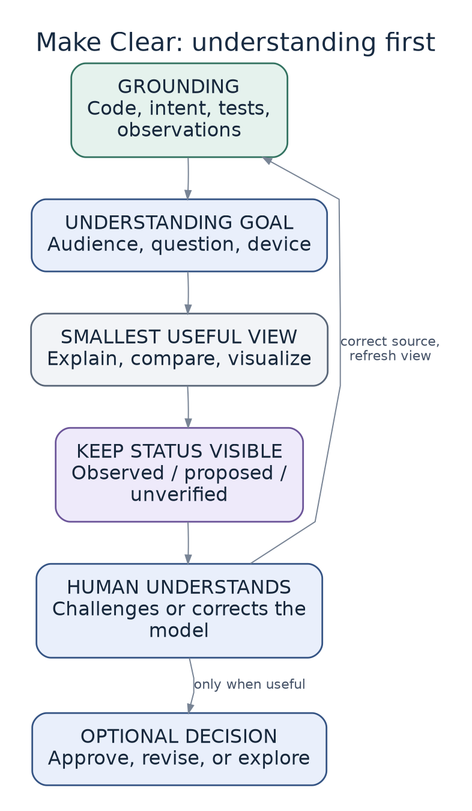
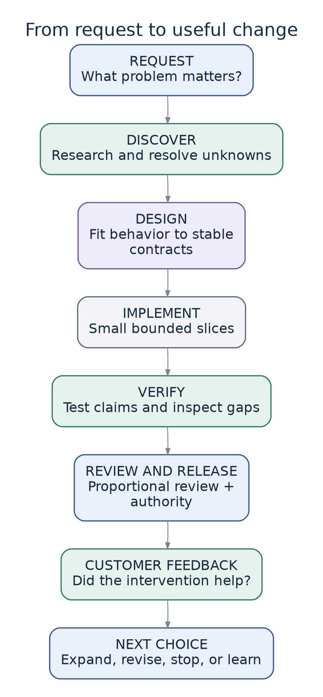
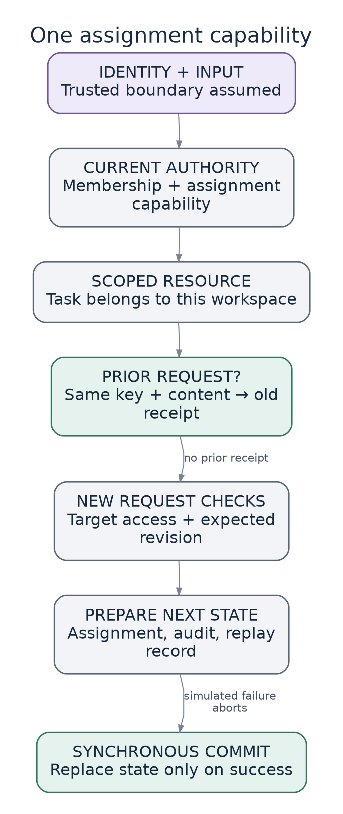

# Diagram guide

Eight focused diagrams connect the big-picture model to concrete implementation. PNGs are embedded beside relevant prose for immediate reading. SVGs support scaling, and Mermaid exports are editable technical views.

## Source of truth

The `source/*.json` files are canonical graph definitions. `scripts/render_diagrams.py` generates matching `.mmd`, `.dot`, SVG, and PNG files and records hashes in `manifest.json`. Edit JSON, not generated exports. The graph semantics are shared; Graphviz and Mermaid may lay out the same graph differently.

Run from the repository root with Graphviz installed:

```bash
python3 scripts/render_diagrams.py
python3 scripts/build_reader.py
python3 scripts/check_docs.py
```

The prepared images were actually rendered with Graphviz. Mermaid exports use simple flowchart syntax, but an independent Mermaid engine and GitHub's remote rendering have not been executed here. The static image fallback does not depend on either. Graphviz version changes can change pixels; regenerate the manifest with the images and inspect the result.

## Reading a view

A view is deliberately incomplete. Its caption states the question and important limits. Arrows describe conceptual flow or dependency as noted; they do not establish implementation evidence. Most views are proposed models. The assignment view describes the limited synchronous teaching model, not deployed infrastructure.

## Catalogue

### What are we optimizing?

Proposed levels of the problem. Lower-level activity is justified by its contribution to higher-level outcomes; more activity is not automatically more value.

[JSON](source/01-levels.json) · [Mermaid](source/01-levels.mmd) · [SVG](rendered/01-levels.svg)



### Three connected learning loops

Proposed operating model, not an observed productivity result. Customer evidence can change the product; engineering evidence can change the implementation; recurring difficulties can change the factory.

[JSON](source/02-three-loops.json) · [Mermaid](source/02-three-loops.mmd) · [SVG](rendered/02-three-loops.svg)


### Where human judgment enters

Authority and evidence are separate. Design agreement does not itself authorize production release. Unexpected consequential choices return to an accountable human.

[JSON](source/03-responsibilities.json) · [Mermaid](source/03-responsibilities.mmd) · [SVG](rendered/03-responsibilities.svg)


### Different documents, different jobs

The full route is shown for clarity. Known-pattern work may skip or combine documents. TDD here is a technical design document. Findings and feedback may revise earlier choices.

[JSON](source/04-planning-artifacts.json) · [Mermaid](source/04-planning-artifacts.mmd) · [SVG](rendered/04-planning-artifacts.svg)



### Deep modules, not long call chains

Two illustrative caller experiences. The second places the operation and its coordination behind one useful interface. A smaller public API alone does not prove that ownership is correct.

[JSON](source/05-module-depth.json) · [Mermaid](source/05-module-depth.mmd) · [SVG](rendered/05-module-depth.svg)



### Make Clear: understanding first

A visual is a view of evidence, not a substitute for it. Understanding can be the endpoint. When a decision is needed, record it separately and update the owning source.

[JSON](source/06-make-clear.json) · [Mermaid](source/06-make-clear.mmd) · [SVG](rendered/06-make-clear.svg)



### From request to useful change

Illustrative feature journey. Small tasks can combine stages. Shipping is an engineering milestone; evaluating the customer outcome requires evidence from use.

[JSON](source/07-feature-journey.json) · [Mermaid](source/07-feature-journey.mmd) · [SVG](rendered/07-feature-journey.svg)



### One assignment capability

Simplified view of the synchronous teaching model. Every failed check returns without mutation. Real authentication, durable transactions, concurrent revocation, and a browser flow remain unimplemented.

[JSON](source/08-assignment-flow.json) · [Mermaid](source/08-assignment-flow.mmd) · [SVG](rendered/08-assignment-flow.svg)



